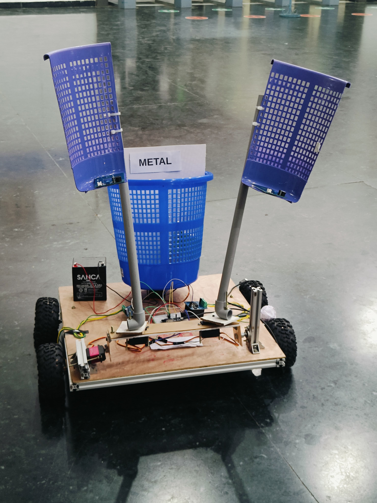
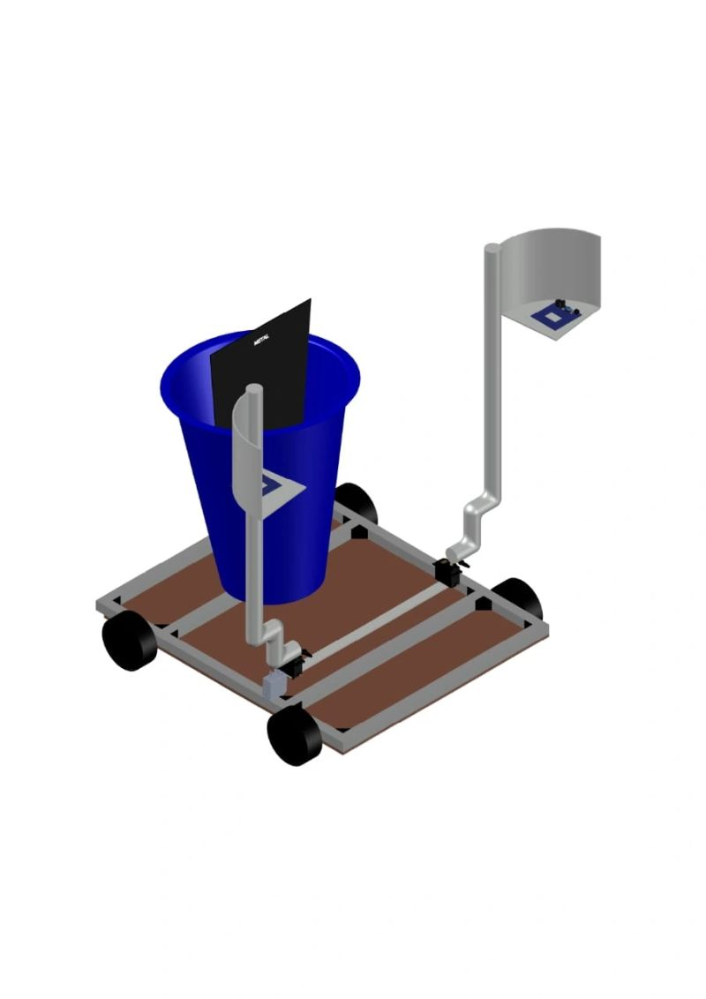
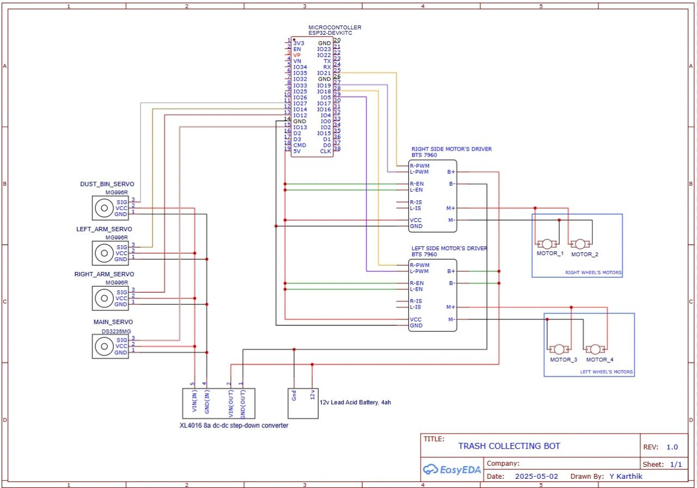
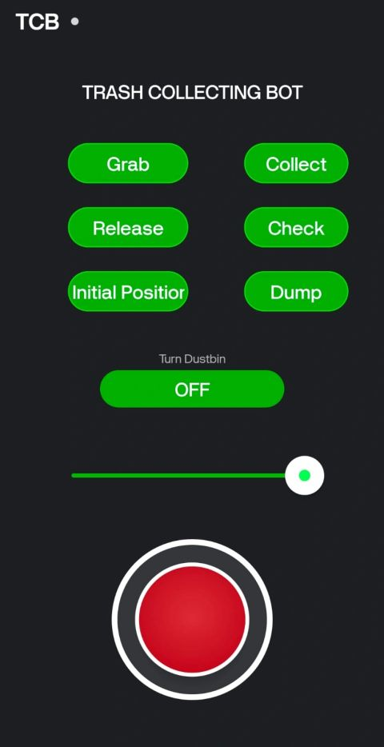
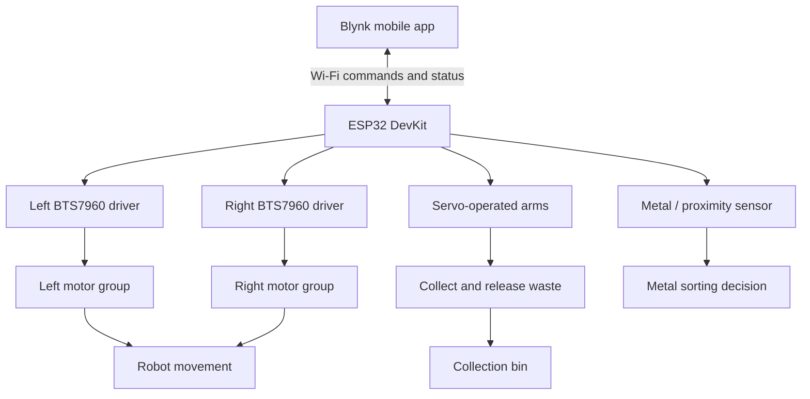

# Manually Controlled Trash Collecting Bot

A remotely controlled waste-collection robot built around an ESP32 and a Blynk mobile interface. The prototype combines a four-wheel drive base, servo-operated arms, a collection bin, and a metal-detection/sorting concept to help reduce direct human contact with collected waste.

## Project Gallery

### Built Robot Prototype

  

### CAD Design

  

### Circuit Diagram

  

### Blynk Mobile Control Interface

  

## Overview

The goal of this project is to build a mobile robot that can be driven remotely to collect trash and help separate metallic waste from non-metallic waste. The operator sends commands from a Blynk mobile interface. The ESP32 receives those commands and controls the drive motors and servo mechanisms.

The uploaded project materials show:
- A four-wheel robot chassis with a central collection bin.
- Two arm-like mechanisms operated by servos.
- A circuit design based on an ESP32 DevKit and two BTS7960 motor-driver modules.
- A Blynk interface with buttons for **Grab**, **Collect**, **Release**, **Check**, **Initial Position**, and **Dump**, plus a dustbin toggle and a slider.
- A metal-labelled bin/sorting concept in the assembled prototype.

This is a **manually controlled prototype**, not a fully autonomous trash-detection robot. The operator controls its actions through the app.

## Features

- **Remote drive control:** Operate the robot through a mobile interface.
- **Four-wheel drive:** Four DC motors provide movement.
- **Servo-operated arms:** Move the arm mechanisms to collect or release waste.
- **Collection bin:** Carry collected waste on the robot.
- **Metal sorting concept:** A metal/inductive sensor is part of the project's waste-separation concept.
- **Blynk interface:** Dedicated controls for collection and arm actions.
- **ESP32-based control:** Wireless commands are handled by the ESP32.

> The exact function of each Blynk button, slider range, and sensor response depends on the firmware and Blynk datastream configuration in the repository.

## Hardware Components

| Component | Role in the project |
|---|---|
| ESP32 DevKit | Main controller and Wi-Fi communication |
| BTS7960 motor drivers (2) | Drive control for the left and right motor groups |
| DC geared motors (4) | Robot movement |
| MG996R servo motors | Dust-bin/arm actuation as labelled in the circuit diagram |
| DS3235MG servo | Main servo mechanism as labelled in the circuit diagram |
| Metal/inductive proximity sensor | Detect metallic material for the sorting concept |
| Blynk mobile app | Remote control interface |
| 12 V, 4 Ah lead-acid battery | Main power source shown in the circuit diagram |
| XL4016 DC-DC buck converter | Steps down the supply for lower-voltage electronics |
| Collection bin | Stores collected waste |
| Robot chassis and wheels | Mechanical platform |

Check component labels and ratings against the actual hardware before wiring or powering the robot.

## System Architecture

## Circuit and Power Design

The provided circuit diagram shows:
- An ESP32 DevKit as the controller.
- Two BTS7960 drivers, one for each motor group.
- Four drive motors grouped as left and right wheel motors.
- Three servo connections.
- A 12 V, 4 Ah lead-acid battery.
- An XL4016 buck converter for a lower-voltage supply rail.

Before operating the robot, verify the supply voltage and current requirements for every module. Servos and motors can draw high startup or stall current, so the buck converter and battery wiring must be rated accordingly. Do not power high-current motors or servos directly from the ESP32 3.3 V output.

## Blynk Control Interface

The supplied app screenshot includes these controls:

| App control | Intended action indicated by its label |
|---|---|
| Grab | Close or operate the grabbing mechanism |
| Collect | Perform a collection action |
| Release | Release the gripped object |
| Check | Check a condition or sensor state |
| Initial Position | Return an arm/mechanism to its starting position |
| Dump | Empty or tip the collection bin |
| Turn Dustbin | Toggle the dustbin-related function |
| Slider | Adjust a configured control value |

The labels describe the interface; the exact behavior and datastream assignments should be confirmed in the project's Blynk and firmware configuration.

## Getting Started

### 1. Prepare the hardware

1. Assemble the chassis, four drive motors, wheels, collection bin, and servo-operated mechanisms.
2. Mount the ESP32 and motor drivers securely.
3. Connect the power system according to the circuit diagram, checking voltage and polarity.
4. Confirm that the motor and servo power supplies can handle their expected current.
5. Keep the robot's wheels raised during the first motor-direction tests.

### 2. Configure the ESP32 firmware

1. Open the project's ESP32 sketch in Arduino IDE.
2. Install any libraries required by that sketch.
3. Configure the Wi-Fi credentials and Blynk device/template credentials if the code uses them.
4. Select the correct ESP32 board and serial port.
5. Compile and upload the firmware.
6. Open Serial Monitor and verify that the board starts and connects to the network.

**Security:** Do not commit Wi-Fi passwords, Blynk authentication tokens, or other private credentials to a public repository. Use placeholders in example files.

### 3. Configure Blynk

1. Create or open the Blynk template/device used by the firmware.
2. Set up the datastreams and widgets expected by the code.
3. Assign each button and slider to the matching virtual pin/datastream.
4. Make sure the app and ESP32 use the same device configuration.
5. Test one control at a time before operating the robot on the floor.

The screenshots alone do not provide the exact virtual-pin mapping, firmware file names, or slider range. Use the code and Blynk configuration in the repository as the source of truth.

### 4. Test the robot

1. Test each servo without a load.
2. Test each motor at low speed with the wheels raised.
3. Verify forward, reverse, left, right, and stop behavior.
4. Test Grab, Collect, Release, Initial Position, and Dump separately.
5. Test the metal sensor with known metallic and non-metallic objects.
6. Test the robot on a clear, flat surface at low speed.
7. Check battery voltage and wiring temperature during operation.

## Safety Notes

- This is an educational prototype, not a certified waste-handling or industrial robot.
- Keep hands, clothing, and loose wires away from wheels, gears, and servo linkages.
- Test with the wheels raised and the mechanism unloaded before floor operation.
- Add appropriate fusing and a physical power-disconnect switch.
- Ensure the robot can be stopped quickly if Wi-Fi or the app disconnects.
- Do not handle hazardous, sharp, contaminated, or unknown waste with this prototype.
- Secure the battery and protect exposed wiring against short circuits.
- Verify the metal sensor's operating distance and the actual sorting mechanism before relying on it.

## Future Improvements

- Add a clearly documented emergency-stop behavior.
- Add connection-loss handling and a safe motor-stop state.
- Improve the mechanical arm and gripper for more reliable collection.
- Document exact ESP32 GPIO assignments and Blynk virtual pins.
- Add battery-voltage monitoring and low-battery alerts.
- Add sensor feedback to confirm successful pickup and dumping.
- Record repeatable tests for metal detection and sorting accuracy.
- Consider onboard perception as a future extension; the current project materials describe manual app control.

## Project Images

All supplied project images are included in the `assets/` folder so GitHub can render them directly from this README.

## Author and Repository

**Project:** Manually Controlled Trash Collecting Bot  
**Repository:** [JOTHIRNADHREDDY/Manually-Controlled-Trash-Collecting-Bot](https://github.com/JOTHIRNADHREDDY/Manually-Controlled-Trash-Collecting-Bot)

Built to explore embedded control, mobile robotics, servo actuation, and practical waste collection.
